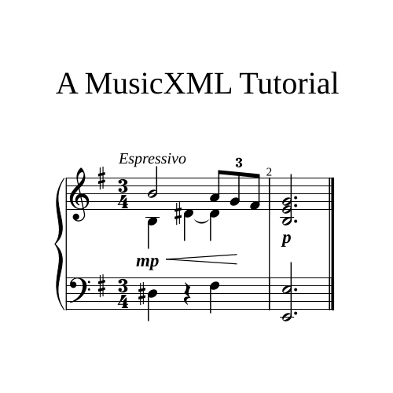

In this post I'll compare the markup of a small musical passage in MusicXML and MEI, and touch upon some other points of comparison in the process.

## Existing Comparisons

Among the scattered paragraphs, presentations and comments that exist online comparing MusicXML and MEI, most refer to versions long-since retired (and thus of limited relevance), others repeat possibly-biased points about developer-friendliness that I've found hard to substantiate, and none (bar one, if I'm being kind) commit to a meaningful comparison of the actual markup behind a sample passage of music.

In this post I'll try to redress some of these shortcomings by focusing on a small passage of music that was built up over [a series of tutorials on MusicXML](/tag/musicxml/). For the sake of brevity, it will be a broad-strokes comparison rather than a line-by-line inspection, but by the end of the post the most important differences between the two standards should be apparent.

## Origins and Aims

First off, it's only fair to clarify that MusicXML and MEI were never intended to directly compete with one another. Yes, they're both open-source XML formats for the representation of music notation, but they were developed for different reasons.

MEI, which stands for Music Encoding Initiative, is an umbrella term for a markup language, an organization, and the community that supports it. It is the older of the two formats, created by Perry Rolands in 1999. It was developed as an encoding format for musical documents (manuscripts, critical editions etc) with an intended audience of academics in fields such as musicology and the digital humanities. As such, it focuses on representing the semantics and depth of historical musical documents mainly for the purposes of preservation and research.

MusicXML, on the other hand, had from the start a more immediate and practical aim: to become the de-facto format for the interchange of sheet music between  different software applications. And it has, to that end, succeeded. If you want to export or import music notation from one piece of software to another (e.g. from Sibelius to MuseScore) MusicXML is the go-to file format. It largely restricts itself to Common Western Notation from the 17th century onwards, so is less ambitious in scope than MEI (which also supports neumes and mensural notation).

MusicXML was created by Michael Good and first released in 2004, initially under the stewardship of Recordare LLC, Good's own commercial entity, and later, MakeMusic, the developers of Finale. In 2015 however development was taken over by the W3C Music Notation Community Group. It is still being actively maintained and improved, but work has been underway on its planned successor, MNX, <a href="https://www.w3.org/community/music-notation/2016/05/19/introducing-mnx/" target="_blank">since 2016</a>. And although it remains to be seen whether MNX will in fact replace MusicXML "out in the wild" so to speak, MEI has no comparative threat of being deemed a legacy format.


## The Music We'll Mark Up

Below is the two-bar passage for which we'll compare the markup. As you can see, it features two staves with a time and key signature, notes of different durations, a rest, chords, separate voices, beams, a barline, and some directions and dynamics. It gives us more material for a meaningful comparison than a single middle C (the typical 'hello world' of musical markup) without being needlessly long or repetitive.




## The MusicXML

The MusicXML markup clocks in at 263 lines.

```xml
<?xml version="1.0" encoding="UTF-8" standalone="no"?>
<!DOCTYPE score-partwise PUBLIC "-//Recordare//DTD MusicXML 4.0 Partwise//EN" "http://www.musicxml.org/dtds/partwise.dtd">
<score-partwise version="4.0">
  <work>
    <work-title>A MusicXML Tutorial</work-title>
  </work>
  <part-list>
    <score-part id="p1">
      <part-name print-object="no"></part-name>
    </score-part>
  </part-list>
  <part id="p1">
    <measure number="1">
      <attributes>
        <key>
          <fifths>1</fifths>
          <mode>minor</mode>
        </key>
        <divisions>4</divisions>
        <time>
          <beats>3</beats>
          <beat-type>4</beat-type>
        </time>
        <staves>2</staves>
        <clef number="1">
          <sign>G</sign>
          <line>2</line>
        </clef>
        <clef number="2">
          <sign>F</sign>
          <line>4</line>
        </clef>
      </attributes>
      <direction placement="above">
        <direction-type>
          <words>Espressivo</words>
        </direction-type>
        <staff>1</staff>
      </direction>
      <direction placement="below">
        <direction-type>
          <dynamics>
            <mp/>
          </dynamics>
        </direction-type>
        <staff>1</staff>
      </direction>
      <direction placement="below">
        <direction-type>
          <wedge type="crescendo" />
        </direction-type>
        <staff>1</staff>
      </direction>
      <note>
        <pitch>
          <step>B</step>
          <octave>4</octave>
        </pitch>
        <duration>4</duration>
        <voice>1</voice>
        <type>half</type>
        <staff>1</staff>
      </note>
      <note>
        <pitch>
          <step>A</step>
          <octave>4</octave>
        </pitch>
        <duration>1</duration>
        <voice>1</voice>
        <type>eighth</type>
        <staff>1</staff>
        <beam number="1">begin</beam>
        <time-modification>
          <actual-notes>3</actual-notes>
          <normal-notes>2</normal-notes>
        </time-modification>
        <notations>
          <tuplet type="start" bracket="no" placement="above" />
        </notations>
      </note>
      <note>
        <pitch>
          <step>G</step>
          <octave>4</octave>
        </pitch>
        <duration>1</duration>
        <voice>1</voice>
        <type>eighth</type>
        <staff>1</staff>
        <beam number="1">continue</beam>
        <time-modification>
          <actual-notes>3</actual-notes>
          <normal-notes>2</normal-notes>
        </time-modification>
      </note>
      <note>
        <pitch>
          <step>F</step>
          <octave>4</octave>
          <alter>1</alter>
        </pitch>
        <duration>1</duration>
        <voice>1</voice>
        <type>eighth</type>
        <staff>1</staff>
        <beam number="1">end</beam>
        <time-modification>
		  <actual-notes>3</actual-notes>
          <normal-notes>2</normal-notes>
        </time-modification>
        <notations>
          <tuplet type="stop"/>
        </notations>
      </note>
      <backup>
        <duration>7</duration>
      </backup>
      <note>
        <pitch>
          <step>B</step>
          <octave>3</octave>
        </pitch>
        <duration>2</duration>
        <type>quarter</type>
        <voice>2</voice>
        <staff>1</staff>
      </note>
      <note>
        <pitch>
          <step>D</step>
          <alter>1</alter>
          <octave>4</octave>
        </pitch>
        <duration>2</duration>
        <type>quarter</type>
        <accidental>sharp</accidental>
        <voice>2</voice>
        <staff>1</staff>
        <notations>
          <tied type="start"/>
        </notations>
      </note>
      <note>
        <pitch>
          <step>D</step>
          <alter>1</alter>
          <octave>4</octave>
        </pitch>
        <duration>2</duration>
        <type>quarter</type>
        <accidental>sharp</accidental>
        <voice>2</voice>
        <staff>1</staff>
        <notations>
          <tied type="stop"/>
        </notations>
      </note>
      <backup>
        <duration>6</duration>
      </backup>
      <note>
        <pitch>
          <step>D</step>
          <alter>1</alter>
          <octave>3</octave>
        </pitch>
        <duration>2</duration>
        <type>quarter</type>
        <accidental>sharp</accidental>
        <staff>2</staff>
      </note>
      <note>
        <rest/>
        <duration>2</duration>
        <type>quarter</type>
        <staff>2</staff>
      </note>
      <note>
        <pitch>
          <step>F</step>
          <alter>1</alter>
          <octave>3</octave>
        </pitch>
        <duration>2</duration>
        <type>quarter</type>
        <staff>2</staff>
      </note>
      <direction placement="below">
        <direction-type>
          <wedge type="stop" />
        </direction-type>
        <staff>1</staff>
      </direction>
    </measure>
    <measure number="2">
      <direction placement="below">
        <direction-type>
          <dynamics>
            <p/>
          </dynamics>
        </direction-type>
        <staff>1</staff>
      </direction>
      <note>
        <pitch>
          <step>B</step>
          <octave>3</octave>
        </pitch>
        <duration>6</duration>
        <type>half</type>
        <staff>1</staff>
        <dot />
      </note>
      <note>
        <pitch>
          <step>E</step>
          <octave>4</octave>
        </pitch>
        <duration>6</duration>
        <type>half</type>
        <staff>1</staff>
        <chord />
      </note>
      <note>
        <pitch>
          <step>G</step>
          <octave>4</octave>
        </pitch>
        <duration>6</duration>
        <type>half</type>
        <staff>1</staff>
        <chord />
      </note>
      <backup>
        <duration>6</duration>
      </backup>
      <note>
        <pitch>
          <step>E</step>
          <octave>2</octave>
        </pitch>
        <duration>6</duration>
        <voice>5</voice>
        <type>half</type>
        <dot/>
        <staff>2</staff>
      </note>
      <note>
        <chord/>
        <pitch>
          <step>E</step>
          <octave>3</octave>
        </pitch>
        <duration>6</duration>
        <voice>5</voice>
        <type>half</type>
        <dot/>
        <staff>2</staff>
      </note>
    </measure>
  </part>
</score-partwise>
```

## The MEI

The same piece in MEI (with just the title modified) clocks in at 88 lines.

```xml
<?xml version="1.0" encoding="UTF-8"?>
<?xml-model href="https://music-encoding.org/schema/dev/mei-all.rng" type="application/xml" schematypens="http://relaxng.org/ns/structure/1.0"?>
<?xml-model href="https://music-encoding.org/schema/dev/mei-all.rng" type="application/xml" schematypens="http://purl.oclc.org/dsdl/schematron"?>
<mei xmlns="http://www.music-encoding.org/ns/mei" meiversion="6.0-dev">
  <meiHead>
    <fileDesc>
      <titleStmt>
        <title>An MEI Tutorial</title>
      </titleStmt>
      <pubStmt/>
    </fileDesc>
  </meiHead>
  <music>
    <body>
      <mdiv>
        <score>
          <scoreDef>
            <staffGrp bar.thru="true">
              <grpSym symbol="brace"/>
              <staffDef n="1" lines="5" ppq="4">
                <clef shape="G" line="2"/>
                <keySig mode="minor" sig="1s"/>
                <meterSig count="3" unit="4"/>
              </staffDef>
              <staffDef n="2" lines="5" ppq="4">
                <clef shape="F" line="4"/>
                <keySig mode="minor" sig="1s"/>
                <meterSig count="3" unit="4"/>
              </staffDef>
            </staffGrp>
          </scoreDef>
          <section>
            <measure n="1">
              <staff n="1">
                <layer n="1">
                  <note dur.ppq="4" dur="2" oct="4" pname="b"/>
                  <beam>
                    <tuplet num="3" numbase="2" num.place="above" bracket.place="above" bracket.visible="false">
                      <note dur.ppq="1" dur="8" oct="4" pname="a"/>
                      <note dur.ppq="1" dur="8" oct="4" pname="g"/>
                      <note dur.ppq="1" dur="8" oct="4" pname="f" accid.ges="s"/>
                    </tuplet>
                  </beam>
                </layer>
                <layer n="2">
                  <note dur.ppq="2" dur="4" oct="3" pname="b"/>
                  <note xml:id="y1t87b0y" dur="4" dur.ppq="2" oct="4" pname="d" accid="s" />
                  <note xml:id="boi0u2" dur="4" dur.ppq="2" oct="4" pname="d" accid="s" />
                </layer>
              </staff>
              <staff n="2">
                <layer n="1">
                  <note dur.ppq="2" dur="4" oct="3" pname="d" accid="s" />
                  <rest dur.ppq="2" dur="4"/>
                  <note dur.ppq="2" dur="4" oct="3" pname="f" accid.ges="s"/>
                </layer>
              </staff>
              <dir place="above" staff="1" tstamp="1">Espressivo</dir>
              <dynam place="below" staff="1" tstamp="1" vgrp="2000">mp</dynam>
              <hairpin staff="1" tstamp="1" tstamp2="0m+2.5" form="cres" place="below" vgrp="2000"/>
              <tie startid="#y1t87b0y" endid="#boi0u2"/>
            </measure>
            <measure n="2" end="right">
              <staff n="1">
                <layer n="1">
                  <chord dots="1" dur.ppq="6" dur="2">
                    <note oct="3" pname="b"/>
                    <note oct="4" pname="e"/>
                    <note oct="4" pname="g"/>
                  </chord>
                </layer>
              </staff>
              <staff n="2">
                <layer n="1">
                  <chord dots="1" dur.ppq="6" dur="2">
                    <note oct="2" pname="e"/>
                    <note oct="3" pname="e"/>
                  </chord>
                </layer>
              </staff>
              <dynam place="below" staff="1" tstamp="1" vgrp="2000">p</dynam>
            </measure>
          </section>
        </score>
      </mdiv>
    </body>
  </music>
</mei>
```

## Size and Structural Approach

While the MusicXML version makes for a longer file (263 vs 88 lines of code), we should also consider the footprint in terms of file size, as MEI will sometimes pack far more text into a single line than MusicXML.

| Format | Lines of Code  | File Size | 
|---|---|---|
| MusicXML | 263 | 6.4 kB |
| MEI | 88 (- 66%) | 4.3 kB (- 32%) |

As you can see, the MEI file is **66% shorter** but only **32% smaller** overall. And this point isn't about the efficiency of the file format (which compression largely deals with on the MusicXML front) but about getting a sense of how much text it takes to convey the same (or similar) information. Of the two MEI is clearly the more concise.

### Attributes vs Elements

The main reason for this concision is that MEI favours attributes over elements, and tends to truncate terms where possible. MusicXML on the other hand is very much an element-first format, and it spells things out more explicitly. Let's use the first note of the base clef to make this clearer. Here it is in MusicXML:

```xml
<note>
  <pitch>
    <step>D</step>
    <alter>1</alter>
    <octave>3</octave>
  </pitch>
  <duration>2</duration>
  <type>quarter</type>
  <accidental>sharp</accidental>
  <staff>2</staff>
</note>
```

And here's the same note in MEI, sitting on a single line:

```xml
<note dur.ppq="2" dur="4" oct="3" pname="d" accid="s" />
```

Rather than having a nested `<octave>` element, we have a truncated `@oct` attribute. And instead of a `<pitch>` element with a nested `<step>` to define the pitch name, we simply have a `@pname` attribute. And the same can be said for `<duration>` and `@dur`, `<accidental>` and `@accid`. More concise, if less immediately obvious.

Personally, I prefer the MEI approach. Some would argue (<a href="https://www.musicxml.com/publications/makemusic-recordare/xml-2006/prefer-clarity-over-concision/" target="_blank">as does the original author of the MusicXML spec, Michael Good</a>) that this concision comes at the cost of clarity, but I've always felt that MusicXML goes overboard on its insistence upon elements. Dynamics are a case in point: from `p` all the way up to `pppppp`, each dynamic has its own dedicated (and always-empty) element, whereas MEI has a single `<dynam>` element and the particular dynamic you're looking for you can simply insert as content. Clearer, if you ask me.

## Logical Groupings

One of the other MEI design decisions I like is the handling of related elements, such as notes within chords, or sequences of notes within voices. 

### Chords and Tuplets

Let's start with chords. We have a couple of chords within the example, but let's focus on the final chord in the treble clef. In MusicXML, notes within chords are connected sequentially - the first note proceeds as normal, and a `<chord>` element is appended to any subsequent notes that should build on top of the initial note. In this way the `<chord>` element is a little like hitting a pause button.

```xml
<note>
  <pitch>
    <step>B</step>
    <octave>3</octave>
  </pitch>
  <duration>6</duration>
  <type>half</type>
  <staff>1</staff>
  <dot />
</note>
<note>
  <pitch>
    <step>E</step>
    <octave>4</octave>
  </pitch>
  <duration>6</duration>
  <type>half</type>
  <staff>1</staff>
  <chord />// [!code highlight]
</note>
<note>
  <pitch>
    <step>G</step>
    <octave>4</octave>
  </pitch>
  <duration>6</duration>
  <type>half</type>
  <staff>1</staff>
  <chord />// [!code highlight]
</note>
```

MEI takes a structural rather than sequential approach, and groups the notes of a chord within a `<chord>` element.

```xml
<chord dots="1" dur.ppq="6" dur="2">
  <note oct="3" pname="b"/>
  <note oct="4" pname="e"/>
  <note oct="4" pname="g"/>
</chord>
```

Comparing the two it seems hard to argue that the verbosity of MusicXML makes it clearer here; on the contrary, not only is MEI far less repetitive (e.g. notice how the notes inherit the duration of the parent `<chord>` element) but it's much easier to comprehend at a glance what's going on.

When we look at how beamed tuplets are handled, the verbosity is even more apparent. This is partly because MusicXML tries to accommodate MIDI where possible, so information relating to how something should sound often sits side by side with the purely presentational aspect (i.e. the notation). In the below excerpt, the `<time-modification>` element is more relevant for playback, and the `<tuplet>` element, nested within `<notations>`, handles how it should appear.


```xml
<note>
  <pitch>
    <step>A</step>
    <octave>4</octave>
  </pitch>
  <duration>1</duration>
  <voice>1</voice>
  <type>eighth</type>
  <staff>1</staff>
  <beam number="1">begin</beam>// [!code highlight]
  <time-modification>// [!code highlight]
    <actual-notes>3</actual-notes>// [!code highlight]
    <normal-notes>2</normal-notes>// [!code highlight]
  </time-modification>// [!code highlight]
  <notations>// [!code highlight]
    <tuplet type="start" bracket="no" placement="above" />// [!code highlight]
  </notations>// [!code highlight]
</note>
```

MEI doesn't make a binary playback-vs-presentation distinction, so how the music sounds vs how it looks isn't simply delegated to different elements. MEI recognises not two but **four** domains, or aspects, of music notation:

- The logical (the musical content or structure, such as pitches, time and key signatures, articulations and dynamics)
- The visual (the physical appearance of the score, on page or screen)
- The gestural (how the music sounds during particular performances)
- The analytical (additional commentary and/or analysis)

While certain elements may be more relevant to some domains than others, MEI in general doesn't split elements by domain. In the case of the beamed tuplet, the logical and visual aspects are captured within the same nested structure.

```xml
<beam>
  <tuplet num="3" numbase="2" num.place="above" bracket.place="above" bracket.visible="false">
    <note dur.ppq="1" dur="8" oct="4" pname="a"/>
    <note dur.ppq="1" dur="8" oct="4" pname="g"/>
    <note dur.ppq="1" dur="8" oct="4" pname="f" accid.ges="s"/>
  </tuplet>
</beam>
```

### Staves and Voices

In the example piece, there are two staves and, in the first measure of the treble clef, two voices. MusicXML handles these simultaneous-yet-separate sequences of notes by using special `<backup>` and `<forward>` instructional elements that essentially allow us rewind or fast-forward to certain points along the score's timeline.

For example, after the final note of the tuplet (`F`) in the treble clef, the next note below it is the `B` in the second (lower) voice. To get this to appear at the correct point in the timeline, the `<backup>` element is used to rewind the duration by 7 "ticks" (the amount of durational units that have elapsed so far in the first voice, taking into account the tuplet's time modification).

```xml
<note>
  <pitch>
    <step>F</step>
    <octave>4</octave>
    <alter>1</alter>
  </pitch>
  <duration>1</duration>
  <voice>1</voice>// [!code highlight]
  <staff>1</staff>
  ...
</note>
<backup>// [!code highlight]
  <duration>7</duration>// [!code highlight]
</backup>// [!code highlight]
<note>
  <pitch>
    <step>B</step>
    <octave>3</octave>
  </pitch>
  <duration>2</duration>
  <type>quarter</type>
  <voice>2</voice>// [!code highlight]
  <staff>1</staff>
</note>
```

Staves work similarly. In the second measure below, moving from the last note of the chord in the treble clef to the first note of the chord in the base clef, we again use the MusicXML `<backup>` element to "rewind" to the correct point in the timeline.

```xml
<note>
  <pitch>
    <step>G</step>
    <octave>4</octave>
  </pitch>
  <duration>6</duration>
  <type>half</type>
  <staff>1</staff>// [!code highlight]
  <chord />
</note>
<backup>// [!code highlight]
  <duration>6</duration>// [!code highlight]
</backup>// [!code highlight]
<note>
  <pitch>
    <step>E</step>
    <octave>2</octave>
  </pitch>
  <duration>6</duration>
  ...
  <staff>2</staff>// [!code highlight]
</note>
```

In MEI, voices are handled via layer container elements. We don't proceed from the final `F` of the tuplet in the first voice to the `B` of the second voice like we do in MusicXML. Instead, notes specific to a certain voice are nested within a `<layer>` element and numbered accordingly using the `@n` attribute. No backup needed.

```xml
<layer n="1">// [!code highlight]
  <note dur.ppq="4" dur="2" oct="4" pname="b"/>
  <beam>
    <tuplet num="3" numbase="2" num.place="above" bracket.place="above" bracket.visible="false">
      ...
      <note dur.ppq="1" dur="8" oct="4" pname="f" accid.ges="s"/>
    </tuplet>
  </beam>
</layer>
<layer n="2">// [!code highlight]
  <note dur.ppq="2" dur="4" oct="3" pname="b"/>
  ...
</layer>
```

Staves, again, are similar. They each have their own dedicated `<staff>` element, and like layers, an `@n` attribute is used to number them.

```xml
<staff n="1">// [!code highlight]
  <layer n="1">
    <chord dots="1" dur.ppq="6" dur="2">
      <note oct="3" pname="b"/>
      <note oct="4" pname="e"/>
      <note oct="4" pname="g"/>
    </chord>
  </layer>
</staff>
<staff n="2">// [!code highlight]
  <layer n="1">
    <chord dots="1" dur.ppq="6" dur="2">
      <note oct="2" pname="e"/>
      <note oct="3" pname="e"/>
    </chord>
  </layer>
</staff>
```

## Hierarchical Approach

The last significant point of departure between the two standards is how parts and measures are handled. Should parts (and by parts we mean instruments with one or more dedicated staves) be nested within measures, or should measures be nested within parts?

In MEI, measures are higher-up in the hierarchy than individual parts, meaning parts (or staves) are nested within measures.

```xml
<measure n="1">// [!code highlight]
  <staff n="1">
    ...
  </staff>
  <staff n="2">
    ...
  </staff>
</measure>// [!code highlight]
```

In MusicXML, the opposite is typically the case. MusicXML supports two different ways of organising parts and measures: **timewise** (similar to MEI, where parts are nested within measures) and **partwise** (where measures are nested within parts). Adopting one or the other means using the relevant root element: `<score-timewise>` or `<score-partwise>`.

Most notation programs have adopted the partwise approach when exporting scores as MusicXML, meaning that the vast majority of MusicXML files that you're likely to come across have `<score-partwise>` as the root element. Our example score is no different.

```xml
<score-partwise version="4.0">// [!code highlight]
  ...
  <part id="p1">
    <measure number="1">
      ...
    </measure>
  </part>
</score-partwise>
```

This dominance has led to the deprecation of the timewise approach as of version 4.1 of the MusicXML standard. The upshot of this is that the hierarchical approach of MEI and MusicXML will likely remain a point of divergence into the future.

## Summary

So to recap, both MEI and MusicXML are long-established and battle-tested formats developed for different end-goals. MusicXML is primarily an interchange format that allows for the transfer of scores between different notation programs, whereas MEI is mainly an encoding format for research and preservation and supports mensural and other historical forms of notation.

MusicXML is the more verbose of the two, and favours elements over attributes. MEI's use of attributes and truncated terms, on the other hand, makes it much more concise, evident when comparing uncompressed file sizes and lines of code. MusicXML element names may be spelled out more explicitly, but it's hard to argue that it's more readable on that front alone, especially when we take MEI's grouping of elements like chords, beams and staves into account. And finally, from the point of view of score hierarchy, MusicXML tends to privileges parts over measures whereas MEI takes the opposite approach.

